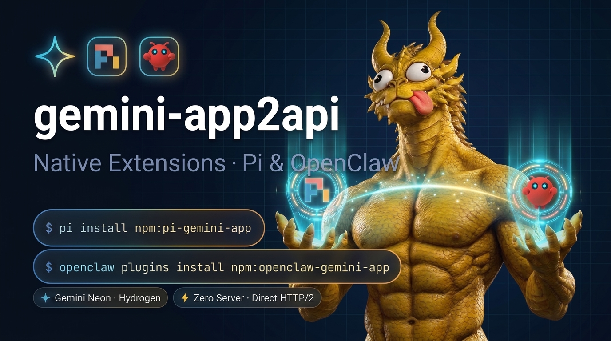

<div align="center">

# Gemini App2API

**你的开发工具、你的 Gemini 订阅账号、零依赖原生 HTTP/2。**

通过免服务器的独立进程内插件，或支持多账号池化的纯 Node.js 网关，将你合资格的 Google Gemini 账号直接接入 **Pi**、**OpenClaw**、**Cursor**、**Cline**、**Roo Code**、**Codex CLI** 与官方 OpenAI SDK。

[](https://github.com/awesomeroy-cloud/gemini-app2api/actions/workflows/ci.yml)
[](https://www.npmjs.com/package/pi-gemini-app)
[](https://www.npmjs.com/package/openclaw-gemini-app)


[](LICENSE)

[English](README.md) · **简体中文** · [繁體中文](README.zh.md) · [快速开始](#quick-start) · [连接客户端](#connect-your-client) · [模型与配额](#quota-consumption) · [审计页面与功能](#audit-log) · [API 参考](docs/API_SUPPORT.md) · [运维指南](docs/OPERATIONS.md)

</div>

> [!IMPORTANT]
> **非官方互通性研究项目。** 与 Google 无任何关联或背书关系。你必须以本人合资格的 Google 账号亲自登录；本项目不分发任何凭据、Token 或 Google 二进制文件。详阅 [DISCLAIMER.md](DISCLAIMER.md)。

---

<a id="quick-start"></a>
## 快速开始

### 路线 A — 独立原生插件（免启动网关服务器）



<a id="pi-extension"></a><a id="openclaw-plugin"></a>

| 客户端 | 安装命令 | 登录与查询配额 | 说明 |
|---|---|---|---|
| **Pi / GooeyPi** | `pi install npm:pi-gemini-app` | `/login gemini-app` · `/gemini-quota` | [`extensions/pi/README.md`](extensions/pi/README.md) |
| **OpenClaw** | `openclaw plugins install npm:openclaw-gemini-app` *（或 ClawHub）* | `openclaw models auth login --provider gemini-app` · `/usage` | [`extensions/openclaw/README.md`](extensions/openclaw/README.md) |

两款插件均在进程内直连原生 HTTP/2（`15s` PING 保活、`HTTPS_PROXY` 支持、256 工具声明、并行多图上传、免费账号自动切换 `gemini-auto`）。

### 路线 B — 自建 OpenAI 兼容网关服务器

需要 **Node.js `>= 22`**（macOS / Linux / WSL2）或 **Docker Compose**，以及具备 Gemini 访问权限的 Google 账号（AI Studio API Key 属不同服务）。

**Node.js：**

```sh
git clone https://github.com/awesomeroy-cloud/gemini-app2api.git && cd gemini-app2api
npm ci --omit=dev --ignore-scripts
npm start
```

**Docker Compose：**

```sh
git clone https://github.com/awesomeroy-cloud/gemini-app2api.git && cd gemini-app2api
read -r -s -p '管理密码（至少 8 位，建议 12 位以上）: ' GATEWAY_ADMIN_PASSWORD; echo
export GATEWAY_ADMIN_PASSWORD && docker compose up -d --build
```

<details>
<summary><strong>自定义端口、TLS 反向代理与远端 SSH 转发</strong></summary>

完整 Docker / Linux 环回发布、Nginx / Caddy TLS 反代配置与远端 OAuth 回调转发（`ssh -N -L 18765:127.0.0.1:18765 <host>`）请见[运维指南](docs/OPERATIONS.md#docker--linux-loopback-publishing--linux-docker-本機發佈)。

</details>

**在浏览器完成初始化：** 打开 **http://127.0.0.1:18989/admin/** → **账号 → + Google 登录** → 点击 **测试** 验证模型权限 → **API 密钥 → 创建密钥**。

---

<a id="connect-your-client"></a>
## 连接客户端

| 配置项 | 填写值 |
|---|---|
| **Base URL** | `http://127.0.0.1:18989/v1` *（或 Compose 内网 `http://gateway:18989/v1` / 自建 HTTPS 反代地址）* |
| **API Key** | 在后台 **API 密钥** 创建的客户端密钥 |
| **模型** | `gemini-neon` *（旗舰 Pro；`gemini-argon` 自动别名至此）*、`gemini-hydrogen` *（高速）*、`gemini-flash-lite` |
| **端点** | `GET /v1/models` · `POST /v1/chat/completions` · `POST /v1/responses`（[完整规格](docs/API_SUPPORT.md)） |

```sh
curl -fsS http://127.0.0.1:18989/v1/chat/completions \
  -H "Authorization: Bearer $GEMINI_GATEWAY_KEY" \
  -H "Content-Type: application/json" \
  -d '{"model":"gemini-neon","messages":[{"role":"user","content":"你好！"}]}'
```

<details>
<summary><strong>常用客户端配置模板 — Codex CLI、Cursor、Cline / Roo Code、Cherry Studio、OpenAI SDK</strong></summary>

- **OpenAI Codex CLI（`~/.codex/config.toml`）** — 原生 `/v1/responses` 与 `namespace` 工具：
  ```toml
  model = "gemini-hydrogen" # 或 "gemini-neon"
  model_provider = "gemini_app2api"
  model_reasoning_summary = "none"
  web_search = "disabled"

  [model_providers.gemini_app2api]
  name = "Gemini App2API"
  base_url = "http://127.0.0.1:18989/v1"
  env_key = "GEMINI_GATEWAY_KEY"
  wire_api = "responses"
  ```
- **Cline / Roo Code：** 选择 `OpenAI Compatible`，Base URL 填 `http://127.0.0.1:18989/v1`，模型填 `gemini-hydrogen` 或 `gemini-neon`。
- **Cursor：** Settings → Models 新增 `gemini-neon` / `gemini-hydrogen` → 开启 Override OpenAI Base URL（若走 Cursor 云端中继需使用 HTTPS 地址）。
- **Cherry Studio / Open WebUI / SDK：** 新增 OpenAI Provider 指向 `http://127.0.0.1:18989/v1`；完整示例见 [`examples/client.mjs`](examples/client.mjs) 与 [`examples/client.py`](examples/client.py)。

</details>

---

<a id="quota-consumption"></a>
## 模型与配额

| 模型别名 | 定位 | 原生模式 | 建议 `context_window` |
|---|---|---:|---|
| **`gemini-neon`** | Gemini 4 Neon 旗舰 Pro 深度推理与开发（`gemini-argon` 自动别名至此） | `PRO` (`3`) | `512,000` |
| **`gemini-hydrogen`** | Gemini 4 Hydrogen 低延迟日常推理（约快 1.7–2.6 倍、更省额度） | `FAST` (`1`) | `512,000` |
| **`gemini-flash-lite`** | 高吞吐轻量任务 | `6` | — |

Gemini AI Pro 账号实测 `GetUsageInfo` 参考数据（`neon_pro_policy`，非官方 SLA 承诺）：

| 工程负载 | `gemini-hydrogen` | `gemini-neon` | Neon 倍率 |
|---|---|---|---:|
| 大型 Code Review + 全文件重写（`thinking=2`） | 每周 `~0.12%`（`~76s`） | 每周 `~0.25%`（`~198s`） | `~2.0×` |
| 多工具 Agent 调用步骤（`thinking=2`） | 每周 `~0.024%`（`~8s`） | 每周 `~0.037%`（`~14s`） | `~1.56×` |
| 标准 ~14 KB 规划输出（`thinking=0`） | 每周 `~0.017%`（`~28s`） | 每周 `~0.086%`（`~36s`） | `~5.1×` |
| 单账号 5 小时滚动窗口推估容量 | `~40` 次大重写 / `~210` 次工具步 | `~20` 次大重写 / `~135` 次工具步 | — |

---

<a id="audit-log"></a>
## 审计页面与扩充功能（Fork 新增）

本 Fork 在保持零第三方运行时依赖的前提下，新增以下生产能力：

### 1. 持久化 SQLite 审计模块（`/admin/#audits`）
- **存储引擎：** 使用 Node.js 22 内置 `node:sqlite`，数据落盘于 `${GATEWAY_DATA_DIR}/audit.db`（Docker 为 `/data/audit.db`，权限 `0600`，WAL 模式），采用 `audit_meta` + `audit_body` 双表分离与按需延迟建库。
- **自动脱敏与容量边界：**
  - 写入前自动将请求体中的 `data:image|audio|video;base64,...` 替换为占位摘要，并遮罩 `authorization`、`cookie`、`set-cookie`、`x-csrf-token`、`x-api-key` 等敏感请求头。
  - 单字段截断上限：请求体 `256 KiB`、模型回复 `512 KiB`、工具调用 `256 KiB`、错误信息 `64 KiB`。
  - 自动清理：默认保留 `30` 天（可通过环境变量 `GATEWAY_AUDIT_RETENTION_DAYS` 配置）且最多保留 `10,000` 条记录，每小时后台自动清理。
- **审计页面与右侧检视抽屉：**
  - 顶栏快捷入口 **审计日志**（`/admin/#audits`）提供多维筛选（关键词、状态码 `2xx`/`4xx`/`5xx`/`failed`、模型、账号、诊断异常、是否含工具调用）与游标分页（`before_id` / `after_id`）。
  - 点击任意记录行打开右侧抽屉（对齐 `gemini-web2api-go` 布局）：
    - 顶部摘要 KV 网格展示 `Status`、`Model / Served`、`Account / Proxy`、`TTFB / Total`、`Tokens (P/O/Total)`、`Attempts / Tools`、`Issue / Finish`、`Resp ID / Key FP`、`User-Agent`。
    - 分 `内容块`、`MCP / Tools`、`原始报文` 三个页签：**响应内容在上、请求内容在下**，按角色着色左边框，支持一键全部展开/折叠、DOM 级安全 Markdown 排版（含代码块复制与纯文本切换）、JSON 语法高亮、单条导出 JSON、单条删除与一键清空。
- **管理端 API（受管理会话 Cookie + 同源 Origin + CSRF 保护）：**
  - `GET /admin/api/audits?models=1`：返回可选筛选维度、数据库体积与保留天数。
  - `GET /admin/api/audits`：支持 `q`、`status`、`model`、`account`、`issue`、`tools`、`path`、`limit`、`before_id`、`after_id`。
  - `GET /admin/api/audits/:id`：读取单条完整请求/响应审计详情。
  - `DELETE /admin/api/audits/:id` / `DELETE /admin/api/audits`：删除单条或清空全部审计记录。

### 2. 简体中文语言包（`zh-CN`）
- 新增零依赖模块 `src/admin-v2/i18n-zh-cn.js`，覆盖管理台全部 700+ 中文文案与术语本地化（`网关`、`账号`、`密钥`、`会话`、`元数据`、`隐私`、`审计日志`等）。
- 简体中文浏览器首次访问自动启用 `zh-CN`，顶栏提供 `简中` / `繁中` / `English` 快速切换。

### 3. 上游自动同步工作流
- `.github/workflows/sync-upstream.yml` 每日定时拉取 `ShawTim/gemini-app2api@main` 并执行 `git merge`（绝不覆盖或丢弃本 Fork 新增功能）；仅在全部测试与发布校验通过后推送 `main`，遇合并冲突自动回滚并创建 Issue 提示。

---

## 核心特性与架构对比

| 比较维度 | **Gemini App2API** | 网页版 / Cookie 爬虫 | 桌面 App 注入 / MITM |
|---|---|---|---|
| **底层传输** | 纯 Node.js 原生 HTTP/2（`ProcessQuery`）+ 并行图片上传 | 脆弱 DOM / 浏览器 Cookie | Hook 本地二进制 / 拦截 |
| **鉴权与池化** | 标准 Google OAuth（`0600` 私密状态）、多账号容错与官方用量条 | Cookie 频繁过期 / 验证码 | 绑定单一桌面 GUI 窗口 |
| **Agent 稳定性** | 256 工具 Schema 校验、抑制幻觉工具回传、`incomplete: true` 契约 | 无结构校验、易死循环 | 受限于消费级功能 |
| **运行依赖** | Node.js `>= 22`，**`0` 个第三方生产环境依赖** | Playwright / Python 栈 | 绑定系统与 App 版本 |


---

## 文档索引

| 文档 | 说明 |
|---|---|
| [Pi 扩展（`extensions/pi/README.md`）](extensions/pi/README.md) | 适用于 Pi Coding Agent 与 GooeyPi 的独立 `pi-gemini-app` 插件 |
| [OpenClaw 插件（`extensions/openclaw/README.md`）](extensions/openclaw/README.md) | 适用于 OpenClaw 与 ClawHub 的独立 `openclaw-gemini-app` Provider 插件 |
| [API 支持规格（`docs/API_SUPPORT.md`）](docs/API_SUPPORT.md) | 端点、工具、结构化输出、图片、`native_search` 与错误码 |
| [运维指南（`docs/OPERATIONS.md`）](docs/OPERATIONS.md) | `.env` 配置、Docker Compose、TLS 反向代理、`launchd` 与排错 |
| [完成与失败语义（`docs/COMPLETION_CONTRACT.md`）](docs/COMPLETION_CONTRACT.md) | 部分输出保留、零输出 `GENERATION_FAILED` 与 Agent 循环安全 |
| [账号生命周期（`docs/ACCOUNT_LIFECYCLE.md`）](docs/ACCOUNT_LIFECYCLE.md) · [限额与锁定（`docs/LOCKS_AND_LIMITS.md`）](docs/LOCKS_AND_LIMITS.md) | OAuth、ToS 条款、配额遥测、并发与负载边界 |
| [测试契约（`docs/CURRENT_CONTRACT_TESTS.md`）](docs/CURRENT_CONTRACT_TESTS.md) · [安全性（`SECURITY.md`）](SECURITY.md) · [更新记录（`CHANGELOG.md`）](CHANGELOG.md) | 离线 E2E 测试集、安全模型与版本历史 |

---

<div align="center">

[MIT 许可](LICENSE) · [免责声明](DISCLAIMER.md) · [安全政策](SECURITY.md) · [贡献指南](CONTRIBUTING.md)

<sub>非官方自建互通性软件。不分发任何 Google 二进制文件、凭据、Token、账号或模型额度。</sub>

</div>
